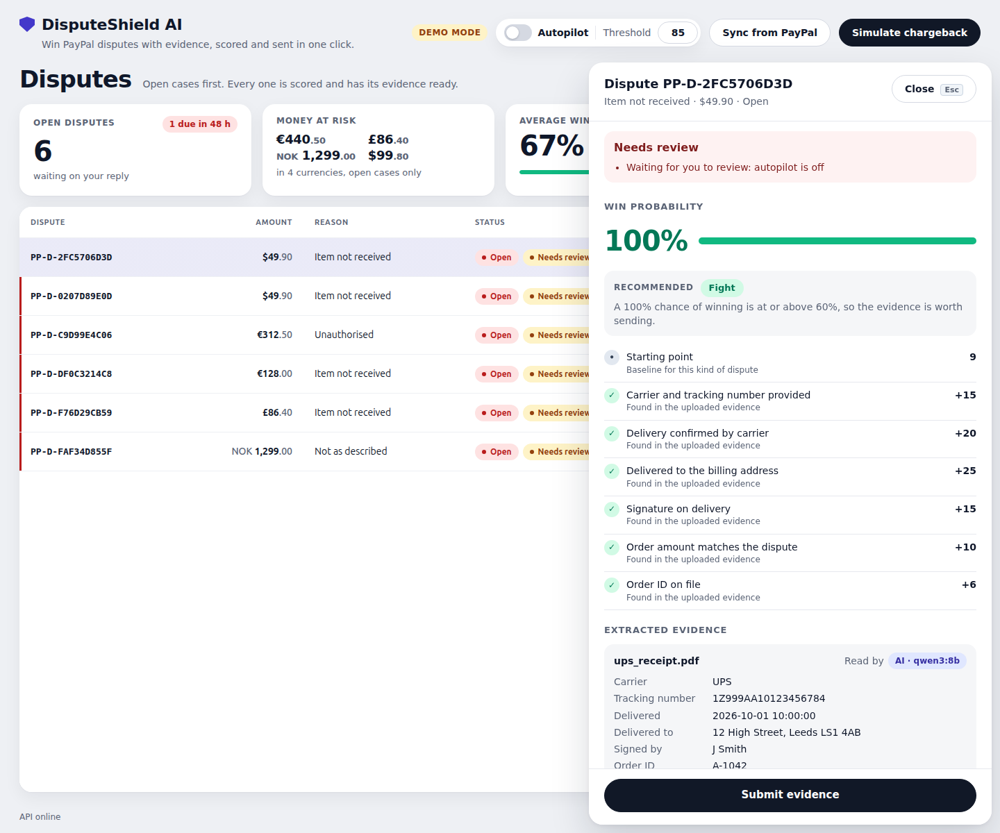
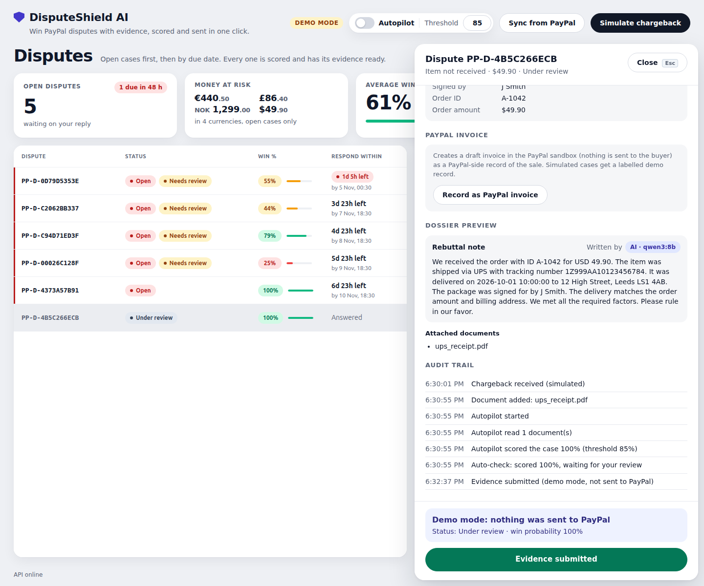
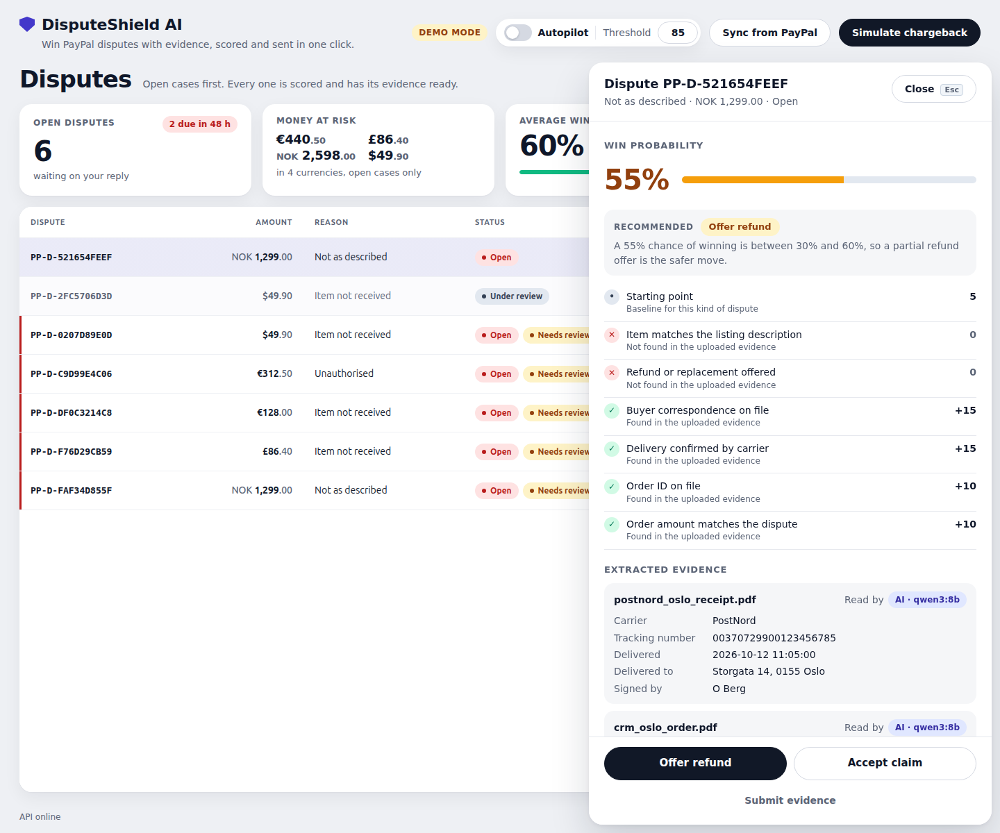
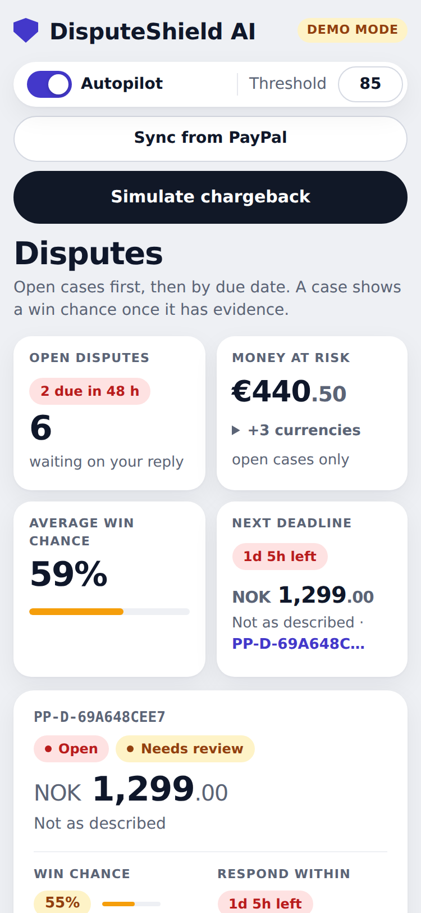
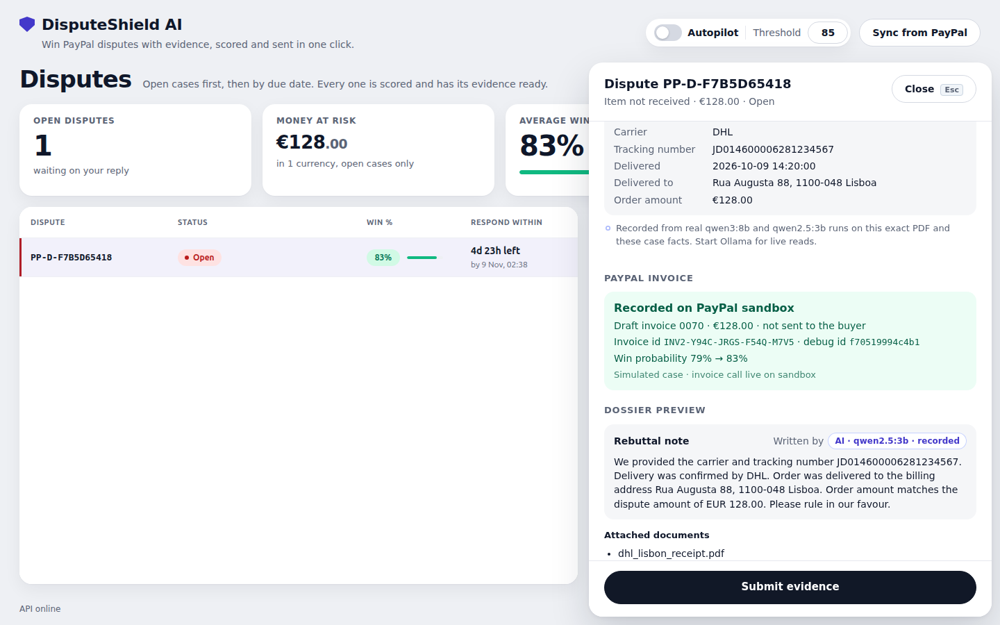
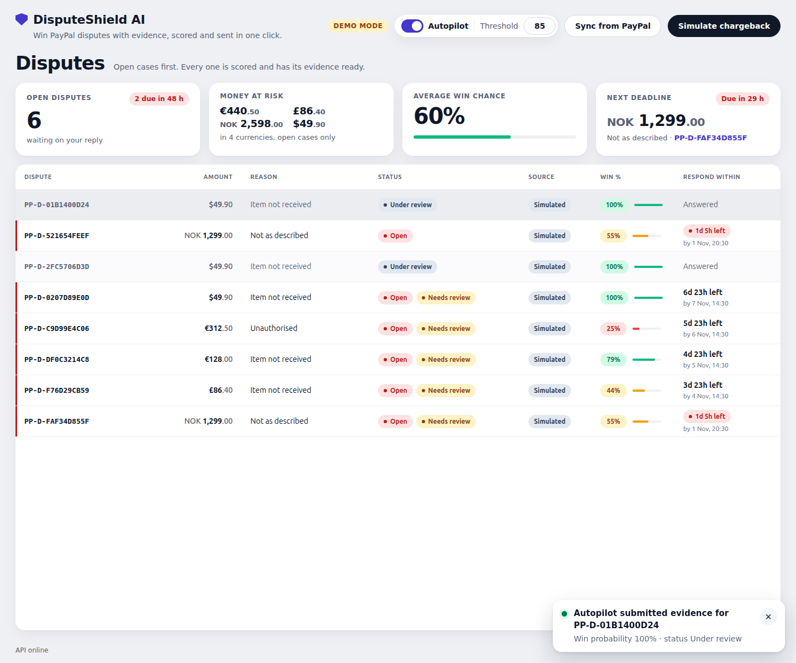

# DisputeShield AI

Chargeback defense for PayPal merchants. It takes in PayPal dispute webhooks, reads your shipping and order PDFs, scores your chances of winning, and sends the evidence to PayPal.



- Code: https://github.com/chrisbuildsonline/disputeshield-ai
- Built for the [PayPal AI Hackathon](https://paypalaihackathon.devpost.com/).

## Try it in 60 seconds

```
docker build -t disputeshield .
docker run --rm -p 127.0.0.1:8000:8000 disputeshield
```

Then open http://localhost:8000 and click **Open demo console**. Demo mode lets anyone who can reach the port in (sandbox only, so the line above publishes it on this machine alone); `-e DISPUTESHIELD_DEMO_MODE=0` turns it off for real use.

## Why it matters

A small merchant gets a PayPal dispute ("item not received"). The proof is in a carrier receipt and an order export. Finding it, typing it up and answering inside the deadline takes time, and many merchants never answer. An unanswered dispute is a lost dispute.

- PayPal gives the seller 10 days. Its seller help page says: "If you don't respond within these 10 days and the buyer escalates it to a claim, we will resolve the case in the buyer's favor." ([PayPal Help Center](https://www.paypal.com/us/cshelp/article/i-am-a-seller---how-do-i-handle-a-dispute-or-problem-with-a-buyer-help1083))
- Disputes are growing. Datos Insights expects 261 million chargebacks worldwide in 2025 and 324 million in 2028. ([Mastercard, 2025 State of Chargebacks report](https://www.mastercard.com/content/dam/mccom/shared/news-and-trends/insights/2025/2025-global-chargebacks-outlook/pdf/2025-state-of-chargebacks-report.pdf))
- Each loss costs more than the sale. In the 2026 LexisNexis True Cost of Fraud study, every $1 of direct fraud loss costs US retail and ecommerce merchants about $5.13 in total. ([LexisNexis Risk Solutions](https://risk.lexisnexis.com/about-us/press-room/press-release/20260624-tcof-retail-and-commerce))

## What it does

For a merchant who sells goods and ships them with a carrier:

1. A dispute arrives as a PayPal webhook (or from a sync of your sandbox disputes).
2. You upload the evidence PDFs, such as a UPS receipt or a CRM order export.
3. A model reads the PDF text into fields: carrier, tracking number, delivery time, address, signature, order id, amount.
4. A fixed rulebook scores the win probability. The model has no say in the score.
5. The app builds an evidence dossier with a short rebuttal note and sends it with PayPal's provide-evidence call.
6. Every step is written to an audit log.

### The demo

The first three controls are in the page header, the last one is on the empty table:

- **Simulate chargeback** (demo mode only) creates an "item not received" dispute for USD 49.90 and attaches the sample UPS receipt (`samples/ups_receipt.pdf`). The model reads it, and the case scores 100%: the receipt has the tracking number, the delivery, the billing address, a signature, the amount and the order id A-1042, so every factor is met.
- **Sync from PayPal** pulls your sandbox disputes. It needs keys (see below).
- **Autopilot** is a switch, with a **Threshold** field next to it (default 85). See [Autopilot](#autopilot).
- **Load sample disputes** adds five made-up cases in four currencies, scored from 25% to 100%. They load at once, with no model call: their receipts are the sample PDFs, and the console shows the reads that a real qwen3:8b run recorded on those exact files (`samples/recorded.json`), so the evidence cards say "Recorded" with the model name. See [Recorded reads](#recorded-reads).

Click a row to open it. With autopilot off, the audit trail says "Auto-check: scored 100%, waiting for your review" and the case is not flagged. Click "Submit evidence". In demo mode nothing leaves your machine, and the panel says "Demo mode: nothing was sent to PayPal". The audit trail lists each step. In the screenshot below, the model wrote the rebuttal note and it passed the fact check, so its badge says "AI · qwen3:8b". A note that fails the check is replaced by the fixed template, and the badge says "Template".



Under 60% the panel recommends a refund offer (30% to 59%) or accepting the claim (under 30%), and the **Offer refund** and **Accept claim** buttons take over. "Submit evidence" stays below them, if you want to fight anyway. Below, a "not as described" case with the sample PostNord receipt and CRM export uploaded scores 55%.



The console works on a phone too:



These screenshots come from `bun run readme:shots`, which drives the real console with qwen3:8b on.

A real call to the PayPal sandbox, with demo mode off:



Live here: the OAuth token, Invoicing v2 create draft invoice and the read back, all on the sandbox. The dispute itself is a seeded simulation (a sandbox dispute needs a sandbox buyer). Reproduce it with `bun run paypal:invoice` (needs the sandbox keys in `.env`; it refuses any other `PAYPAL_API_BASE`).

## Quick start (no keys)

You need Docker with Compose.

```
docker compose up
```

Wait for the build, then find this line in the logs and open the link:

```
Operator console: http://localhost:8000/#token=...
```

Click "Simulate chargeback". Demo mode is on in the compose file and shown with a "Demo mode" badge in the page header. To use another port, run `HOST_PORT=8790 docker compose up`. The logged link still says port 8000 (the port inside the container), so change the port in the link to your `HOST_PORT`.

Compose model: `qwen2.5:3b`

`docker compose up` also starts a CPU-only Ollama container (no GPU needed) and pulls that model into the `ollama-models` volume. The first start downloads about 2 GB, so the console opens a few minutes later. Later starts reuse the volume. Reading a PDF takes about 5 to 15 seconds and the note about 7 seconds on a CPU. To use an Ollama on your own machine instead, set `OLLAMA_HOST` and `DISPUTESHIELD_OLLAMA_MODEL` (see [AI models and tools](#ai-models-and-tools)).

Without any Ollama the app still works, with regex reading and a template note, and the page shows "Regex fallback" and "Template" badges.

## Run it locally (bun)

You need [bun](https://bun.sh), [uv](https://docs.astral.sh/uv/) and Python 3.12.

```
bun install
bun run setup
bun run e2e:install
bun run llm:start
bun run llm:pull
bun run dev
```

- `bun run setup` installs the Python packages (`uv sync`).
- `bun run e2e:install` installs the Chromium that the Playwright tests use. You only need it to run `bun run e2e`.
- `bun run llm:start` and `bun run llm:pull` are optional. They start Ollama as a user systemd service and pull `qwen3:8b` (about 5 GB). If you have Ollama some other way, run `ollama pull qwen3:8b` yourself.
- `bun run dev` builds the console, then serves it on http://localhost:8000 with demo mode on. Open the `#token=` link it logs.

`bun run dev` does not read `.env`. To use keys, export them first:

```
set -a; source .env; set +a
bun run dev
```

## AI models and tools

| Tool | Used for |
| --- | --- |
| qwen3:8b through [Ollama](https://ollama.com) | Default. Reads receipt and CRM PDF text into evidence fields. Drafts the rebuttal note. |
| Claude (optional, default model `claude-sonnet-5-5`) | Same two jobs, if you choose it. |
| pypdf | Turns the PDF into text for the model and for the regex parser. |
| PayPal Disputes API and webhooks | Reads disputes, verifies webhooks, provides evidence. |
| PayPal Invoicing API (v2) | Records the disputed order as a draft invoice in the sandbox and reads it back. |
| AG Grid Community | The dispute table in the console. |

Pick the model with `DISPUTESHIELD_LLM`:

Leave it unset and the app uses Claude when `ANTHROPIC_API_KEY` is set, otherwise Ollama. Setting `ollama` or `off` always wins over the key.

- `ollama` (the default without a key). The server is `OLLAMA_HOST` (default `http://localhost:11434`) and the model is `DISPUTESHIELD_OLLAMA_MODEL` (default `qwen3:8b`).
- `claude` (the default when the key is set) needs `ANTHROPIC_API_KEY`. Set explicitly without the key it acts like `off`. Set `DISPUTESHIELD_CLAUDE_MODEL` to change the model id.
- `off` uses only the regex parser and the template note.

What the model does, and the guards around it:

- It reads the PDF text and fills the evidence fields. The text is treated as data, and the prompt tells the model to ignore instructions inside it.
- A tracking number, order id or amount must appear in the PDF text, or it is dropped.
- A labelled line in the PDF ("Tracking Number: ...") beats what the model returned for that field.
- Fields the model leaves empty are filled by the regex parser.
- The rebuttal note is written from the extracted facts only, then fact-checked. Any id, amount, date or time that is not in the dispute or the evidence rejects the note, and a fixed template note is used instead.
- If the model is down or fails, a recorded read takes over if there is one for the exact same PDF (see below). Otherwise the regex parser and the template take over. The detail panel shows who did the work: an "AI" badge with the model name, "Recorded" with the model name, "Regex fallback" or "Template".

### Recorded reads

Live: any new PDF and any new dispute is read and written up by the model (Ollama or Claude) whenever it is reachable. Nothing is faked there.

Recorded: `samples/recorded.json` holds what a real qwen3:8b run returned for each sample PDF (keyed by the SHA-256 of the file's bytes) and the rebuttal notes it wrote for the sample cases (keyed by the SHA-256 of the facts it was given). They are used only when no model is reachable, so a judge who runs the plain Docker image without Ollama still sees real model output on the samples. A recorded read goes through the same guards as a live one (ids must appear in the PDF text, the regex parser fills gaps), and a recorded note still has to pass the fact check. A PDF with different bytes is never matched, and the regex parser reads it. For each sample case, `bun run llm:record` tries real model attempts until one note passes the fact check; the model that wrote each note is named in the file. qwen3:8b wrote the Leeds and Oslo notes, and qwen2.5:3b wrote Lisbon, Bristol and Madrid after qwen3:8b mangled their tracking numbers. Re-record with `bun run llm:record` (needs Ollama and qwen3:8b).

Docker and Ollama: by default the compose file points the app at its own `ollama` container (`http://ollama:11434`) and the model above (`qwen2.5:3b`, the smallest non-thinking model that read both sample PDFs correctly and wrote a note that passed the fact check; `qwen2.5:0.5b` and `1.5b` did not). The sidecar port is not published, so it cannot clash with an Ollama on your host. To use the host's Ollama and `qwen3:8b` instead, run `OLLAMA_HOST=http://host.docker.internal:11434 DISPUTESHIELD_OLLAMA_MODEL=qwen3:8b docker compose up`. On plain Linux Docker, the host's Ollama listens on 127.0.0.1 by default and the container cannot reach it, so start it with `OLLAMA_HOST=0.0.0.0`. If `OLLAMA_HOST` is already set in your shell, unset it or the compose file will use it. `bun run llm:try <model>...` measures candidate models in a throwaway CPU container.

## PayPal sandbox keys (free)

Keys let the app talk to the real PayPal sandbox. They are free.

1. Go to https://developer.paypal.com and log in with a PayPal account, or sign up for one.
2. Open Apps & Credentials and switch to **Sandbox**.
3. Click Create App, give it a name, pick the Merchant type and create it. If the app page lists features, make sure Disputes is on.
4. Copy the Client ID and the Secret.
5. Copy `.env.example` to `.env` and fill in:

```
PAYPAL_CLIENT_ID=<client id>
PAYPAL_CLIENT_SECRET=<secret>
```

6. Restart. With compose, `docker compose up` reads `.env` by itself. With bun, export it as shown above.

`PAYPAL_API_BASE` defaults to `https://api-m.sandbox.paypal.com`. The app refuses to send evidence to any host that is not a `.sandbox.paypal.com` host.

What works with keys:

- `POST /api/paypal/sync` (alias `/api/disputes/sync`) pulls the first page of your sandbox disputes into the console and returns `{count, fetched_at, debug_id, mode, disputes}` (call it with the operator token, for example from `curl -X POST -H "Authorization: Bearer <token>" http://localhost:8000/api/paypal/sync`).
- The score route recommends an action: fight at 60% or more, offer a refund from 30% to 59%, accept the claim below 30%. `POST /api/disputes/{id}/accept` (optional `{note}`) and `POST /api/disputes/{id}/offer` (`{amount, note}`) act on it, calling PayPal's sandbox for PayPal disputes and recording a labelled demo result otherwise; each dispute allows one act or evidence submission.
- A second PayPal API family, Invoicing: `POST /api/disputes/{id}/paypal-invoice` creates a draft invoice (`POST /v2/invoicing/invoices`, nothing is sent to the buyer) for the disputed order and reads it back (`GET /v2/invoicing/invoices/{id}`), as a PayPal-side record of the agreed sale. A recorded invoice adds one small score factor (up to 4 points, never past 100) and is kept in the audit trail with PayPal's debug id. It only runs against the sandbox. Simulated disputes get a fixed fixture labelled "Demo mode", not a PayPal answer. A repeat call returns the first record. (Transaction Search would have been the natural fit, but the sandbox app's token has no reporting scope.)
- Submitting a dispute that came from PayPal calls PayPal's provide-evidence endpoint with the dossier and the PDFs, then reads the dispute status back. The UI says "Sent to PayPal sandbox".

The honest limit: a sandbox dispute has to be opened by a sandbox buyer account on the sandbox website (sandbox.paypal.com). You pay a sandbox merchant with a sandbox buyer, then open a dispute as that buyer. There is no REST-only way to create one. Zero synced disputes is a normal result until you do that. This is why the demo has its own simulated chargeback.

### Webhooks

To receive real events, add a webhook to the sandbox app (Webhooks, Add Webhook). The URL must be public HTTPS, for example from a tunnel, and must point at `/api/webhooks/paypal`. Subscribe to the dispute created, updated and resolved events. Copy the Webhook ID into `PAYPAL_WEBHOOK_ID`.

- With `PAYPAL_WEBHOOK_ID` set, every webhook is checked with PayPal's verify-webhook-signature call. A bad or missing signature is refused.
- Without it, the webhook is refused with `503`, unless demo mode is on. Demo mode (`DISPUTESHIELD_DEMO_MODE=1`) accepts unsigned webhooks and stores them as "Simulated".

## Environment variables

All are in `.env.example`. The ones you are likely to set:

| Variable | Meaning |
| --- | --- |
| `DISPUTESHIELD_OPERATOR_TOKEN` | Fixed operator token. Blank means a random one per start. |
| `DISPUTESHIELD_DEMO_MODE` | `1` turns on the simulated chargeback and unsigned webhooks. On in compose and `bun run dev`. |
| `PAYPAL_CLIENT_ID`, `PAYPAL_CLIENT_SECRET` | Sandbox REST app credentials. |
| `PAYPAL_WEBHOOK_ID` | Turns on webhook signature checks. |
| `PAYPAL_API_BASE` | PayPal host. Sandbox only. |
| `DISPUTESHIELD_LLM` | `ollama`, `claude` or `off`. Unset: Claude if `ANTHROPIC_API_KEY` is set, else Ollama. |
| `OLLAMA_HOST`, `DISPUTESHIELD_OLLAMA_MODEL` | Ollama server and model. |
| `ANTHROPIC_API_KEY`, `DISPUTESHIELD_CLAUDE_MODEL` | Optional Claude. |
| `DISPUTESHIELD_DB` | SQLite file. Default `data/disputeshield.db`. |
| `HOST_PORT` | Published port for `docker compose up`. Default 8000. |

## Operator token

The app never runs open. Every `/api` route (disputes, documents, scores, submit, sync, autopilot, the demo chargeback) needs `Authorization: Bearer <token>`. Without it the server answers `401` with `Operator token needed`.

- Set the token with the `DISPUTESHIELD_OPERATOR_TOKEN` environment variable.
- If it is unset or blank, the server makes a random token on every start.
- With a random token, the server logs a link when it starts: `Operator console: http://localhost:8000/#token=...` (the port is `PORT`, default 8000). Open it once. The page keeps the token in the browser and removes it from the address bar.
- With `DISPUTESHIELD_OPERATOR_TOKEN` set, the token is never logged. The server logs `Operator console: http://localhost:8000/ (token from DISPUTESHIELD_OPERATOR_TOKEN)`, and the page asks you to paste the token (or open `/#token=<your token>` yourself).
- Open on purpose: `GET /api/health`, `GET /api/config` and the PayPal webhook `POST /api/webhooks/paypal`. The webhook has its own signature check (or demo mode). The page itself holds no data, so it is open too.

## Autopilot

Autopilot is off by default. Turn it on with the switch in the page header, and set the threshold in the field next to it (default 85). The same settings are at `GET /api/autopilot` and `PUT /api/autopilot` with a body like `{"enabled": true, "threshold": 85}`.

It runs when a new dispute webhook arrives and when you add a document to a dispute. For each dispute it reads the evidence on file and scores it. Then:

- At or above the threshold, it submits the evidence, exactly as the submit button would.
- Below the threshold, or with no documents, or on an error, it does not submit (autopilot on or off). It flags the dispute "Needs review" and lists the reasons, including the score factors that were not met.
- Closed disputes and disputes that were already submitted are skipped.

Each step is written to the audit log. The demo chargeback always runs the agent once, so with autopilot off a well-scored case gets an "autopilot_awaiting" audit row ("scored 100%, waiting for your review") and no "Needs review" flag. With it on, the next "Simulate chargeback" is read, scored 100% and submitted with no click, and the console says so in a toast.



## Architecture

```
PayPal webhook / sync / demo chargeback
        |
        v
  webhooks.py  --> store.py (SQLite: disputes, documents, submissions, audit)
        |
  PDF upload --> extract.py (pypdf text -> model or regex -> guards)
        |
        v
  scorecard.py + scoring.py (deterministic win probability)
        |
        v
  dossier.py (evidence JSON, PDFs, rebuttal note, fact check)
        |
        v
  submit.py --> paypal.py (provide-evidence)  --> audit log
        ^
  autopilot.py (runs the same steps on its own)
```

| Path | Role |
| --- | --- |
| `app/main.py` | FastAPI app, wiring, health and config routes, serves the console. |
| `app/auth.py` | Operator token middleware and the console link. |
| `app/webhooks.py` | Webhook intake, signature check, dispute list and detail. |
| `app/store.py` | SQLite storage and the audit log. |
| `app/extract.py` | PDF text to evidence fields, with the guards. |
| `app/llm.py` | Picks the model and makes the Ollama call. |
| `app/scoring.py`, `app/scorecard.py` | The scorer, and the glue from stored rows to the scorer. |
| `app/dossier.py` | Builds the PayPal evidence payload and the rebuttal note. |
| `app/submit.py` | Documents, score preview, submit, audit and sync routes, demo chargeback. |
| `app/paypal.py` | OAuth, the Disputes API calls and the Invoicing API calls. |
| `app/autopilot.py` | The autopilot settings and agent. |
| `web/` | The console in TypeScript, built by `bun build` into `app/static`. |
| `samples/` | The sample UPS receipt and CRM order PDFs. |

## Scoring

The win probability is plain arithmetic, the same every time. Each dispute reason has a base number and a list of factors with weights. The score is the base plus the weight of every factor that is met, kept between 0 and 100. The weights are all positive, so more evidence never lowers the score.

For "item not received" the base is 9 and the factors are:

| Factor | Weight |
| --- | --- |
| Carrier and tracking number provided | 15 |
| Delivery confirmed by carrier | 20 |
| Delivered to the billing address | 25 |
| Signature on delivery | 15 |
| Order amount matches the dispute | 10 |
| Order ID on file | 6 |

That adds up to 100. The sample UPS receipt carries every item, order id included, so the walkthrough case passes every check and scores 100. A receipt without an order id would score 94; uploading the sample CRM order export (`samples/crm_order.pdf`) as well supplies it.

There are rulebooks for unauthorised use, item not as described, and a catch-all for other reasons. Some of their factors (address and card checks, prior orders, item matches the listing, refund offered) have no PDF extractor yet, so today they always count as not met.

## Tests and scripts

| Command | What it does |
| --- | --- |
| `bun run test` | Starts Ollama, builds the console, runs the whole pytest suite. |
| `bun run typecheck` | `tsc` for the console and strict `mypy` for `app` and `tests`. |
| `bun run e2e` | Playwright against a server it starts on port 8765, with the model and PayPal off. |
| `bun run e2e:alt` | The same on port 8766, if 8765 is taken. |
| `bun run demo:video` | Runs `bun run test` and `bun run typecheck` first and stops if either is red. Then starts its own server (demo mode, throwaway database, the local model on) and records a narrated tour of the console. Writes `out/disputeshield-demo.mp4` (1920x1080, about 2.5 minutes). Needs Ollama with `qwen3:8b`, `ffmpeg` and `uvx` (for the edge-tts voice). |
| `bun run readme:shots` | Starts its own server (demo mode, throwaway database, the local model on), drives the console with Playwright and saves the README screenshots to `docs/screenshots/`. It stops if any panel shows "Regex fallback" or "Template" instead of the model, or the console logs an error. Needs Ollama with `qwen3:8b`. |
| `bun run demo:frames` | Prints the video's streams and saves a frame every 10 seconds to `out/frame-NN.png`, to look it over. |
| `bun run docker:test` | Builds the image and runs pytest inside it. |
| `bun run docker:e2e` | Runs the Playwright suite against the container. |
| `bun run docker:smoke` | Runs `docker compose up` like a judge, checks the token link, the 401 gate and the page. |
| `bun run smoke:fresh` | Clones HEAD into a temp dir and follows this README there: compose without keys, bun without keys, then with your `.env` if you have one. |

## License

MIT, see LICENSE.
